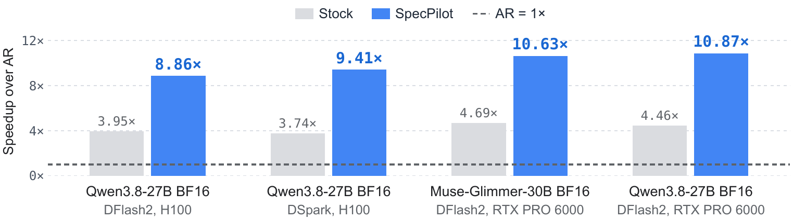
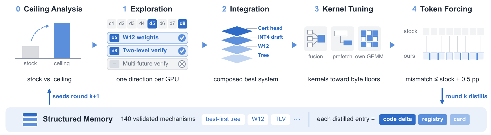
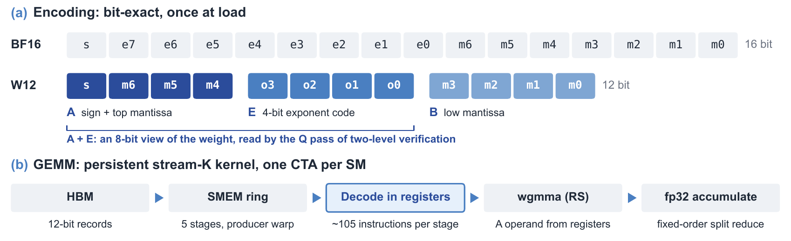

<p align="center">
  <picture>
    <source media="(prefers-color-scheme: dark)" srcset="assets/wordmark_dark.png">
    <source media="(prefers-color-scheme: light)" srcset="assets/wordmark_light.png">
    
  </picture>
</p>

<h3 align="center">Autonomous Algorithm Discovery and Systems Optimization for Speculative Decoding</h3>

<p align="center">
  <a href="https://arxiv.org/abs/2611.02501"></a>
  <a href="https://stargazerx0.github.io/specpilot-project-page/"></a>
  <a href="#citation"></a>
  <a href="LICENSE"></a>
</p>

<p align="center">
  
  <br>
  <em>SpecPilot more than doubles stock's speedup in every setting, without training or quality loss.</em>
</p>

Released speculative decoding systems leave much of their speed unused, and the best fix differs for every deployment.
SpecPilot is an agentic loop that finds lossless optimizations for each one. This repository ships the engine SpecPilot
found for each of six deployments, with the scripts to serve, benchmark and verify them.

## Overview

<p align="center">
  
</p>

In each round of the loop, a cost model locates the largest gaps between the current system and its ceiling. Parallel
agents explore directions and integrate the successful ones, and a kernel sub-agent tunes the kernels furthest from their memory-bandwidth limit. Token
forcing checks every output token against stock to catch outputs that drift from the target model. A structured memory
carries validated mechanisms to new rounds and deployments.

Here *stock* is the released drafter system (DFlash2 or DSpark) without SpecPilot, served on the same engine. Every
SpecPilot engine (*final*) is lossless: decoding is greedy and the target model decides every token. The
[project page](https://stargazerx0.github.io/specpilot-project-page/) has a 40-second overview video.

## Results

Speedup over autoregressive decoding (AR) on the dev split first turns of gsm8k, humaneval, math500, mbpp and mt-bench
(2048 new tokens, geometric mean of per-request speedups). τ is the number of tokens committed per verify step.

| Deployment | GPU | Requests | Stock / AR | SpecPilot / AR | SpecPilot / stock | τ: stock → SpecPilot |
|---|---|---|:---:|:---:|:---:|:---:|
| [Qwen3.8-27B + DFlash2](settings/h100_c1_qwen38-27b_dflash2) | H100 | 1 | 3.95× | **8.86×** | 2.24× | 4.65 → 13.08* |
| [Qwen3.8-27B + DSpark](settings/h100_c1_qwen38-27b_dspark) | H100 | 1 | 3.74× | **9.41×** | 2.52× | 4.42 → 12.85* |
| [Qwen3.8-27B + DFlash2](settings/pro6000_c1_qwen38-27b_dflash2) | RTX PRO 6000 | 1 | 4.46× | **10.87×** | 2.44× | 5.23 → 12.80* |
| [Muse-Glimmer-30B + DFlash2](settings/pro6000_c1_muse-30b_dflash2) | RTX PRO 6000 | 1 | 4.69× | **10.63×** | 2.27× | 5.16 → 12.64* |
| [Qwen3.8-27B FP8 + DFlash2](settings/h100_batch_qwen38-27b-fp8_dflash2) | H100 | 16, 20, 24 | 2.02× | **3.90×** | 1.93× | 4.56 → 5.39 |
| [Qwen3.8-27B FP8 + DSpark](settings/h100_batch_qwen38-27b-fp8_dspark) | H100 | 16, 20, 24 | 1.94× | **3.93×** | 2.03× | 4.37 → 5.42 |

\* The single-request finals use two-level verification (TLV), and τ counts the tokens committed per exact pass, so it
can exceed the 16-token draft block.

H100 is the H100 80GB SXM5 (sm_90). RTX PRO 6000 is the RTX PRO 6000 Blackwell Server Edition 96 GB (sm_120). Stock
runs at the drafter's serving configuration. On the RTX PRO 6000 we re-tuned stock for the card (Qwen: block 12 with
triton attention; Muse: block 16 with flashinfer).

### Reproduced from a fresh clone

We reproduced the four H100 settings from a fresh clone and a fresh environment with `scripts/serve.sh` and
`scripts/bench.sh`, starting a fresh server for every run (stock and SpecPilot 2 runs each, AR 1 run). Brackets give
95% bootstrap CIs.

| Setting | Stock / AR | SpecPilot / AR | SpecPilot / stock | τ: stock → SpecPilot |
|---|:---:|:---:|:---:|:---:|
| `h100_c1_qwen38-27b_dflash2` | 3.96× | 8.91× | 2.25× [2.18, 2.32] | 4.65 → 13.08 |
| `h100_c1_qwen38-27b_dspark` | 3.77× | 9.48× | 2.52× [2.46, 2.58] | 4.42 → 12.85 |
| `h100_batch_qwen38-27b-fp8_dflash2` | 2.05× | 3.96× | 1.94× [1.90, 1.98] | 4.57 → 5.34 |
| `h100_batch_qwen38-27b-fp8_dspark` | 1.92× | 3.91× | 2.04× [2.00, 2.09] | 4.39 → 5.40 |

<details>
<summary>Benchmark scores of the same runs</summary>

<br>

`scripts/score.py` grades gsm8k, humaneval, math500 and mbpp. On the single-request settings, AR, stock and SpecPilot
all score 18/24 (SpecPilot with DSpark 19/24), identically on every repeat. On the batching settings SpecPilot scores
167–172/240 and stock 170–173/240 (stock varies by 2 between its own runs). AR scores 177–178/240 there, 2–3 points
above stock and SpecPilot alike. The 240 rows are 80 items run at three concurrency levels, and many answers are cut
at 2048 tokens, so these scores are a sanity check and not an accuracy evaluation.

</details>

## Quick start

```bash
# 1. Python environment (Python 3.11, torch 2.13 + CUDA 13.0, locked packages; once per machine)
bash scripts/setup_env.sh

# 2. Checkpoints of one setting (or: all)
bash scripts/download_models.sh h100_c1_qwen38-27b_dflash2

# 3. Start a server on GPU 0 (port 30000): final (SpecPilot), stock or ar
bash scripts/serve.sh h100_c1_qwen38-27b_dflash2 final 0

# 4. Speed benchmark, then stop the server
bash scripts/bench.sh h100_c1_qwen38-27b_dflash2 final-1 0
bash scripts/stop.sh 30000

# 5. Repeat steps 3-4 for stock and ar, then compare and score
cd ~/specpilot_data/work/bench
python3 ~/SpecPilot/scripts/compare.py speed --ar ar-1.json --stock stock-1.json --final final-1.json
python3 ~/SpecPilot/scripts/score.py final-1.json stock-1.json
```

The setting names are the folder names in [`settings/`](settings). Data goes under `SPECPILOT_DATA` (default
`~/specpilot_data`): `shared/` holds the venv, checkpoints and build caches, and `work/` holds the assembled engines,
server logs and benchmark results. The servers speak the SGLang HTTP and OpenAI-compatible APIs on
`127.0.0.1:<port>`.

> [!IMPORTANT]
> **Warm up once.** The first boot of each engine compiles its CUDA, Triton and DeepGEMM kernels into a shared cache,
> and some kernels compile on first use. On a fresh install the first measured pass is slower (the batching finals ran
> 10–15% slow at 16 requests on our first run), so run each benchmark once before measuring.

## Models

All checkpoints are public on Hugging Face. Every measurement used the pinned revision below, and
`scripts/download_models.sh` downloads exactly these.

| Model | Used by | Revision |
|---|---|---|
| [Qwen/Qwen3.8-27B](https://huggingface.co/Qwen/Qwen3.8-27B) | single-request Qwen settings | `1d4bf0f2ff6012fd82039f2fa52739d0dd7c60c0` |
| [Qwen/Qwen3.8-27B-FP8](https://huggingface.co/Qwen/Qwen3.8-27B-FP8) | batching settings | `017b9c7af6b5689d5dd426a76e0bc077eb5ca20a` |
| [z-lab/Qwen3.8-27B-DFlash2](https://huggingface.co/z-lab/Qwen3.8-27B-DFlash2) | Qwen + DFlash2 settings | `50307d4c4cde6860d4eee73e2547cd786fe8e8a4` |
| [RadixArk/Qwen3.8-27B-DSpark](https://huggingface.co/RadixArk/Qwen3.8-27B-DSpark) | Qwen + DSpark settings | `b9a5dbdf03bc999c6c73c426b19c2d9041cea393` |
| [meta-models/Muse-Glimmer-30B](https://huggingface.co/meta-models/Muse-Glimmer-30B) | Muse setting | `a4e59da52a7bc87ae7251dd5545c0dd437c44b68` |
| [incoai/Muse-Glimmer-30B-DFlash2](https://huggingface.co/incoai/Muse-Glimmer-30B-DFlash2) | Muse setting | `8336acb8dc9b8bf9c25f12d7785ee6df26703119` |

## What the finals contain

Each setting's README lists its final's mechanisms in full. The main ones:

| Setting | Main mechanisms |
|---|---|
| `h100_c1_qwen38-27b_dflash2` | W12 weights, TLV on the nested 8-bit view of W12, 32-node tree verify, certified exact-argmax LM head |
| `h100_c1_qwen38-27b_dspark` | DSpark adapter, Markov-conditioned draft tree over a union candidate lattice, TLV with an INT6 copy, the target-side stack of the DFlash2 final |
| `pro6000_c1_qwen38-27b_dflash2` | W12 on `mma.sync` for sm_120, tree verify on triton attention, TLV with a scaled INT6/INT8 copy, L2 weight prefetch |
| `pro6000_c1_muse-30b_dflash2` | W12 on sm_120, TLV with a scaled INT6/INT8 copy, top-32 tree verify, L2 weight prefetch |
| `h100_batch_qwen38-27b-fp8_dflash2` | ragged draft trees with a tiered verify budget, FP8 GEMM routing, segment admission of prompts, per-request drafter block length |
| `h100_batch_qwen38-27b-fp8_dspark` | the DFlash2 batching final's target-side mechanisms, batched union-candidate lattice builder |

### W12: a lossless 12-bit weight format

<p align="center">
  
</p>

The four single-request finals stream the target's BF16 weights in W12, at 12.01–12.02 bits per weight on dense
models. Every weight decodes bit-exactly, in registers inside the GEMM. On its own, W12 makes plain BF16 decoding
1.15–1.26× faster on dense 8–30B models at batch 1–32. It beats cuBLAS BF16 up to 64 rows per GEMM (H100: on the
large projections; RTX PRO 6000: on every projection).

## Evaluation

- **`scripts/bench.sh`** runs the paper's workload: first turns of the dev split (20 items per dataset, the prompt
  formats of the DFlash evaluation), greedy, 2048 new tokens. Single-request settings run at concurrency 1 on the
  first 6 items per dataset (`ITEMS=20` for all). Batching settings run closed loop at 16, 20 and 24 concurrent
  requests over all 100 items. It records per-request tokens, latency, verify steps, output ids and text.
- **`scripts/compare.py speed`** reports speedups (geometric mean of per-request rate ratios, 95% bootstrap CI), τ and
  output identity, overall and per dataset as in the paper's tables.
- **`scripts/score.py`** grades a bench run. gsm8k and math500 use the last `\boxed{}`. humaneval and mbpp run the last
  code block against the dataset tests in a sandboxed subprocess. mt-bench is not graded.

Outputs are not bitwise identical to AR for any speculative decoder here, stock included. Verify-time batched GEMMs
and attention reduce in a different order than single-token decoding, so near-ties can flip. We accepted each final
only after a token-level check that every committed token is the target's own choice at that position.

## How the engines are built

One stock engine ships in this repository: an SGLang tree pruned to the paths these settings use (`python/`) and the
experiment plugin (`research/dflash_lab/`). The DSpark settings add the DSpark modules in `overlays/dspark_stock/`.

A final is the stock tree with its setting's `files/` copied on top (no final deletes a file), plus the configuration
in `settings/<setting>/config.json`: the `SPECPILOT_*` environment switches (`final.env`), the verify width
(`final.block_size`) and extra server arguments (`final.launch_args`).

`scripts/build_engine.py <setting> {stock,final} <dir>` assembles a tree and prints its content hash.
`scripts/serve.sh` does this on first use and starts every server with a `PYTHONPATH` that holds only that tree.

## Repository layout

```
settings/<setting>/       README.md, config.json (models, stock and final configuration, paper numbers), files/
python/                   stock engine (pruned SGLang)
overlays/dspark_stock/    DSpark modules added to the stock engine for the DSpark settings
research/env.sh           environment (paths, CUDA compat, caches); requirements.lock.txt: exact packages
research/scripts/         server launchers: launch.sh, serve.sh, stop.sh, wait_ready.sh, protocol_env.py
research/bench/           bench.py (closed-loop client), grade.py, splits/dev (manifest.json: dataset revisions)
scripts/                  setup_env.sh, download_models.sh, build_engine.py, serve.sh, bench.sh, stop.sh,
                          compare.py, score.py
assets/                   figures for this README
```

## Notes

- **Hardware.** Every setting runs on one GPU of the listed type. The CUDA kernels of the RTX PRO 6000 finals are built
  for sm_120a only, and the H100 finals were measured on H100 only.
- **Driver.** torch 2.13 + CUDA 13.0 needs an R580 driver. On older drivers `setup_env.sh` installs NVIDIA's
  forward-compat libcuda and `research/env.sh` puts it on `LD_LIBRARY_PATH` (our H100s ran R550 this way).
- **Muse.** The Muse chat template writes the current date into the system prompt, so run all arms of a comparison
  within one UTC day.

## Citation

```bibtex
@misc{li2026specpilot,
  title         = {SpecPilot: Autonomous Algorithm Discovery and Systems
                   Optimization for Speculative Decoding},
  author        = {Li, Kunjun and Chai, Wenhao and Liang, Yihao and Hu, Yuezhou
                   and Xu, Shuyao and Pan, Yi and Zheng, William X.
                   and Ramchandran, Kannan and Keutzer, Kurt and Jiao, Jiantao},
  year          = {2026},
  eprint        = {2611.02501},
  archivePrefix = {arXiv},
  primaryClass  = {cs.LG},
  url           = {https://arxiv.org/abs/2611.02501}
}
```

## License

Apache License 2.0; see [`LICENSE`](LICENSE). `python/` is derived from [SGLang](https://github.com/sgl-project/sglang).
